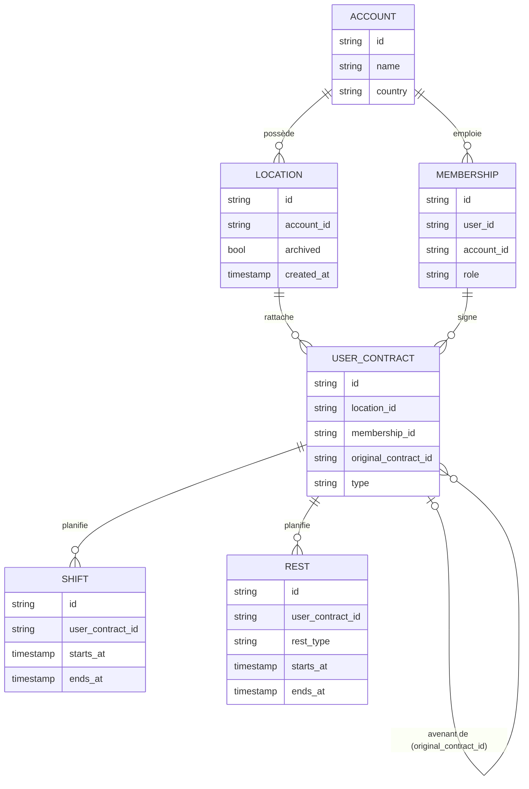

# Le modèle de données Combo, en version simple

## 1. L'idée en une image

On peut se représenter Combo comme un **classeur** :

- Le **client** (account) est le classeur. C'est lui qui paie.
- Chaque **établissement** (location) est une boutique, un restaurant ou un labo du client. **C'est à ce niveau que se calcule le prix.**
- Chaque **personne** (membership) est quelqu'un qui travaille chez le client.
- Le **contrat** (user_contract) est la **feuille qui dit : « cette personne est rattachée à cet établissement »**.
- Les **shifts** et les **repos** (rests) sont les cases cochées dans l'agenda. **Ils sont accrochés au contrat**, jamais directement à la boutique.

```
                    ┌──────────────────────────┐
                    │  ACCOUNT  (le client)    │   ex : Boulangerie Dupont
                    │  id, name, country       │   → c'est lui qui reçoit la facture
                    └────────────┬─────────────┘
                 ┌───────────────┴────────────────┐
                 │ 1 client = N établissements     │ 1 client = N personnes
                 ▼                                 ▼
  ┌──────────────────────────┐        ┌──────────────────────────┐
  │ LOCATION (établissement) │        │ MEMBERSHIP (la personne) │
  │ id, account_id, archived │        │ id, account_id, role     │
  │ → UNITÉ DE FACTURATION   │        │ → "QUI" (sert à compter  │
  └────────────▲─────────────┘        │    chaque personne 1 fois)│
               │                      └────────────▲─────────────┘
               │ location_id                       │ membership_id
               │            ┌──────────────────────┴───┐
               └────────────┤ USER_CONTRACT (contrat)  │
                            │ id, location_id,         │
                            │ membership_id,           │
                            │ original_contract_id     │  ← lien avenant → contrat d'origine
                            │ → "OÙ" la personne compte│
                            └────────────▲─────────────┘
                                         │ user_contract_id
                       ┌─────────────────┴─────────────────┐
              ┌────────┴─────────┐               ┌─────────┴────────┐
              │ SHIFT (travail)  │               │ REST (repos)     │
              │ starts_at,ends_at│               │ starts_at,ends_at│
              │ → "QUAND"        │               │ rest_type        │
              └──────────────────┘               │ → "QUAND"        │
                                                 └──────────────────┘
```

**À retenir :** pour facturer quelqu'un, il faut **qui** (membership), **où** (location) et **quand** (semaine).
Le shift ou le repos donne le **quand**. Le **contrat** donne le **qui** et le **où**.

---

## 2. Même schéma, au format Mermaid



---

## 3. Le cas de Marie : pourquoi on passe par le contrat

```
Shift de Marie (lundi)  ──► Contrat de Marie ──► location = Centre-ville  ✅ compté ici
     (elle a travaillé à la Gare en renfort,
      mais le shift ne porte PAS de location)
```

Le shift n'a **pas** de colonne `location_id`. On est donc **obligé** de passer par le contrat, et c'est exactement la règle de l'énoncé :
on compte la personne sur l'établissement **de son contrat**. **Le modèle de données impose la règle.**

---

## 4. Le calcul de la facture, étape par étape

```
 SHIFTS + REPOS
      │  ① on les met dans une seule liste ("planifications")
      │  ② on éclate chaque planification sur chaque semaine qu'elle touche
      ▼
 (contrat, semaine)
      │  ③ contrat → établissement + personne
      ▼
 (établissement, semaine, personne)
      │  ④ on compte les personnes DISTINCTES
      ▼
 (établissement, semaine, n employés)  ◄── + les établissements à 0 employé (calendrier)
      │  ⑤ on applique la grille  (60 / 80+… / 216+…)
      ▼
 (établissement, semaine, prix)
      │  ⑥ on fait la SOMME par client
      ▼
 (client, semaine, nb établissements, nb employés, revenu)   ◄── Questions 1 et 2
```

**Le piège :** on ne tarife **jamais** le total du client.
Deux boutiques de 4 = 60 + 60 = **120 €**, et non « 8 employés » = 88 €.

---

## 5. Les trous dans les données (contrats manquants)

Le planning pointe parfois vers un contrat **absent** du fichier. Deux cas :

```
 Cas A : récupérable                       Cas B : orphelin
 ─────────────────                         ──────────────
 shift ──► contrat 500 (absent)            repos ──► contrat 777 (absent)
                ▲                                         ▲
   avenant 900 : "je modifie le 500"           (aucun avenant ne le cite)
   → Léa, Gare                                 → on connaît seulement le client

 Qui ✅  Où ✅  → FACTURÉ                    Qui ❓  Où ❓  → NON FACTURÉ
                                             compté dans N_UNASSIGNED_CONTRACTS
```

Pourquoi on ne facture pas le cas B : **le prix dépend de l'établissement.**
La même personne vaut +0 €, +2,4 € ou +4 € selon l'endroit où on la place : la placer au hasard, ce serait inventer un montant.

| Planning | Part |
|---|---|
| Rattaché directement à un contrat | 38 % |
| Récupéré via un avenant (cas A) | 9 % |
| Orphelin (cas B) | 53 % |

---

## 6. Les 3 couches (médaillon)

```
 BRONZE                                   SILVER (logique métier)            GOLD (contrat exposé)
 ──────                                   ───────────────────────            ─────────────────────
 SRC_FILES (stage : CSV reçus)            CONTRACTS_RESOLVED                 BILLING_ACCOUNT_WEEK
    │ COPY INTO                             fichier + reconstruits             1 ligne = compte × semaine
    ▼                                       via avenants                       → Q1 + Q2
 STG_<TABLE>  (texte brut)                WEEKS                              BILLING_LOCATION_WEEK
    │ dbt                                   calendrier + WEEK_STATUS           1 ligne = établissement × semaine
    ▼                                     PLANNING_WEEKS                       (détail de la facture)
 <TABLE>      (typé, 1 pour 1)              shifts + repos éclatés
   ACCOUNTS, LOCATIONS, MEMBERSHIPS,        par semaine                      vues, colonnes et types
   USER_CONTRACTS, SHIFTS, RESTS          BILLING_LOCATION_WEEK              garantis (model contracts)
                                            grille tarifaire
                                          BILLING_ACCOUNT_WEEK
                                            somme par compte
```

### Qui fait quoi ?

| Couche | Rôle | Contient de la logique métier ? |
|---|---|---|
| **Bronze** | Fichiers sources, copie brute (`STG_*`), puis typage et nettoyage 1 pour 1 | Non |
| **Silver** | Règles de facturation : contrats reconstruits, éclatement par semaine, grille, somme par compte | **Oui, et uniquement ici** |
| **Gold** | Vues stables exposées aux consommateurs, colonnes et types garantis | Non (sélection et libellés) |

**Le test :** si la grille tarifaire change, on ne modifie **que la silver** (macro `pricing.sql`). La gold, et donc les consommateurs, ne voient rien.

---

## 7. La gold vue comme un data product

| Élément d'un data product | Chez nous |
|---|---|
| **Consommateurs** | Processus de facturation mensuelle (moyenne des semaines), équipe finance |
| **Contrat d'interface** | Grain fixe (client × semaine), colonnes et types garantis (*model contracts* dbt) |
| **Qualité garantie** | Tests dbt : unicité du grain, grille testée (452 €, 374,4 €), bornes 5/6 et 39/40 |
| **Transparence sur les limites** | `N_UNASSIGNED_CONTRACTS`, `WEEK_STATUS`, README des hypothèses |
| **Documentation** | `dbt docs` : description des colonnes et lineage bronze → gold |
| **Propriétaire** | L'Analytics Engineer |

> *« J'ai pensé la gold comme un data product : son consommateur est la facturation mensuelle. Il a un grain fixe, un contrat de colonnes, des tests sur les règles tarifaires, et il expose ses limites. Toute la logique est en silver : si la grille change, la gold ne bouge pas. »*

---

## 8. Lexique

| Terme | Sens simple |
|---|---|
| **Grain** | Ce que représente **une ligne** d'une table |
| **Orphelin** | Une ligne qui pointe vers un id introuvable |
| **Avenant** | Une modification d'un contrat existant (`original_contract_id`) |
| **Soft delete** | On ne supprime pas, on marque (`archived = true`) |
| **Éclater** | Transformer 1 repos de 3 semaines en 3 lignes (1 par semaine) |
| **Calendrier (date spine)** | La liste de toutes les semaines (`SILVER.WEEKS`), pour facturer aussi les établissements à 0 employé |
| **Date d'extraction** | Le 08/04/2024 : la date de la photo des données (jamais `CURRENT_DATE`) |
